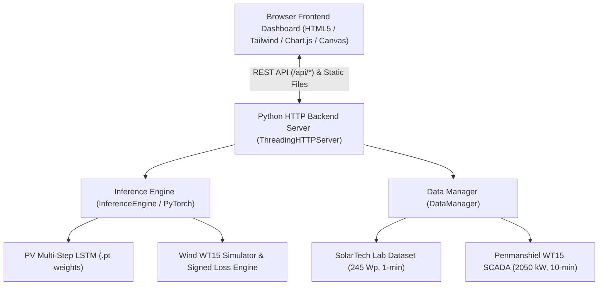

# RampSense — Interactive SCADA Dashboard & Connected AI Backend

RampSense is an interactive industrial energy SCADA platform and multi-threaded Python backend for ultra-short-term ramp event forecasting in Photovoltaic (PV) and Wind Power Generation.

Based on the research project adapting **S. E. Kostoglou et al., "A Novel Combined Objective Hybrid Framework for Ultra-short-term Ramp Event Forecasting in Photovoltaic and Wind Power Generation," IEEE Access, 2026**.

---

## ⚡ Quick Start: Launching the Dashboard

### Method 1: Double-Click (Recommended)
Double-click `start_dashboard.bat` in the project root directory.  
It will automatically launch the Python backend server and open the web dashboard in your default browser at `http://localhost:8000/`.

### Method 2: PowerShell
```powershell
powershell -ExecutionPolicy Bypass -File .\start_dashboard.ps1
```

### Method 3: Manual Command Line
```powershell
& "C:\Users\archa\AppData\Local\Programs\Python\Python311\python.exe" backend\server.py 8000
```
Then navigate to:
```
http://localhost:8000/
```

---

## 🏗️ System Architecture



---

## 🖥️ Dashboard Modules

### 1. 📡 Live SCADA Operations & Ramp Alert Feed
* **Live Telemetry Stream**: Continuous real-time updates of solar and wind generation with sub-second ramp event detection.
* **Dial Gauges**: Real-time meters for PV Power (W), PV Ramp Rate (W/min), Wind Active Power (kW), and Anemometer Wind Speed (m/s).
* **Ramp Alert Banner**: Real-time status banner flashing `CRITICAL`, `WARNING`, or `STABLE` when sudden steep power gradients are forecasted.
* **Operational Event Log**: Timestamped rolling audit log of recent ramp events.

### 2. ☀️ Solar PV Analytics & Threshold Sweep
* **Dataset**: SolarTech Lab (Milan, Italy), nominal rating 245 Wp, 1-minute resolution, 525,601 records.
* **Forecast Horizon**: 8-step target window ($t+6$ to $t+13$ minutes, $h=10, \Delta t=3, \tau=1$ min).
* **Ground-Truth Label Threshold**: 12.25 W/min (5% of rated power).
* **Interactive Decision Threshold Slider**: Drag the slider from $0.5$ to $35.0$ W/min to observe how detection thresholds affect test $F_1$, precision, recall, and PRE flags.
* **Threshold Sweep Curves**: Interactive comparison between Adam MSE baseline (which collapses to $F_1 = 0.0$ at label threshold) versus PSO Warm-Start (achieving peak $F_1 = 0.347$ with optimal threshold at $11.0$ W/min).
* **Model Benchmark Table**: Side-by-side metrics across Adam $H=16$, PSO Warm-Start (seeds 42, 43, 44), PSO Random-Start, SAMURAI C11, and Parameter-Light baselines.

### 3. 💨 Wind WT15 & Direction-Aware Analysis
* **Dataset**: Penmanshiel Wind Farm WT15 (Zenodo), rated 2050 kW (2.05 MW), 10-minute SCADA resolution, 105,120 rows.
* **Ramp Definition**: $\Delta P \ge 205$ kW (10% of rated capacity).
* **Directional Breakdown Showcase**:
  * Standard MSE LSTM: $F_1 = 0.42\%$, misses virtually all ramp events.
  * Soft-$F_1$ ($\phi_{\text{soft}}$): Raises unsigned $F_1$ to $45.55\%$, but Ramp-Up $F_1$ is **$0.0\%$** (detects only ramp-downs!).
  * Signed Soft-$F_1$ + Lag-6: Restores Ramp-Up $F_1$ to **$25.09\%$** and lifts Direction Accuracy to **$66.31\%$**.
* **Interactive Wind Slider**: Adjust $\epsilon$ from 100 to 400 kW to inspect dynamic turbine ramp prevalence.

### 4. 🔬 Research Benchmarks & Ablation Lab
* **Loss Weight Sweep ($w_1 \in [0.0, 1.0]$)**: Visualizes the fundamental trade-off between Level RMSE and Ramp $F_1$. Shows how MSE-only ($w_1=1.0$) suppresses ramp predictions.
* **Ablation Studies Grid**: Evaluates the effect of Lag 1 vs Lag 6 history windows, difference features, and hidden layer sizes (10, 20, 40) across 10 fresh seeds.
* **Neighbor Turbine Influence**: Incorporates SCADA from adjacent turbines (WT11 to WT14).

### 5. ⚡ Live Model Playground & Inference Simulator
* **Preset Scenarios**:
  1. *Cloud Shadow Sudden Drop*: Severe solar ramp down from 850 W/m² to 180 W/m².
  2. *Morning Solar Dawn*: Rapid ramp up from 20 W/m² to 650 W/m².
  3. *Overcast Stable*: Low-variability diffuse daylight.
  4. *Intermittent Broken Clouds*: Highly volatile power swings.
* **Live PyTorch Model Execution**: Runs the multi-step LSTM model in real time, computes predicted power curves, outputs maximum ramp rates, and returns inference latency in milliseconds.
* **Raw JSON Inspector**: View the raw JSON request and response payloads for developer testing.

---

## 🔌 Connected REST API Reference

| Endpoint | Method | Description |
|---|---|---|
| `/api/status` | `GET` | System health, active PyTorch device (CPU/CUDA), and dataset counts. |
| `/api/overview` | `GET` | High-level metadata for SolarTech PV and Penmanshiel Wind systems. |
| `/api/pv/models` | `GET` | Evaluation metrics for all PV models (Adam, PSO warm/random, baselines). |
| `/api/pv/timeseries` | `GET` | Slice of historical PV power, irradiance, actual ramp, and predictions. |
| `/api/pv/sweep` | `GET` | Validation threshold sweep curves ($0$ to $40$ W/min) for Adam vs PSO. |
| `/api/pv/presets` | `GET` | Pre-configured realistic weather scenarios for the playground. |
| `/api/pv/predict` | `POST` | Execute live PyTorch multi-step inference on custom or preset window. |
| `/api/wind/models` | `GET` | Wind models benchmark data and ablation configurations. |
| `/api/wind/timeseries`| `GET` | SCADA wind power, wind speed, direction, and delta power. |
| `/api/wind/direction` | `GET` | Ramp-Up vs Ramp-Down $F_1$, direction accuracy, and bias metrics. |
| `/api/wind/ablation` | `GET` | Summary of lag, differences, and hidden layer ablation runs. |
| `/api/wind/predict` | `POST` | Live wind power and signed directional ramp inference. |
| `/api/telemetry/live` | `GET` | Real-time sequential SCADA tick emulator for live operations. |
